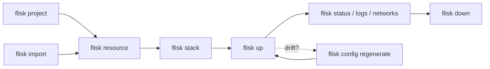

# ⚡ Flisk mega cheat sheet

> Every `flisk` command, alias and flag on one page. Taken from `flisk <command> --help` for **v1.3.125**. Your version may differ, so run `flisk <command> --help` to check.

**Jump to:** [🚀 Start](#-first-five-minutes) · [🔥 Top 10](#-top-10) · [🗺️ Map](#️-how-it-fits-together) · [🌍 Project](#-project) · [📦 Resources](#-resources) · [🗂️ Stacks](#️-stacks) · [▶️ Lifecycle](#️-lifecycle) · [⚙️ Config](#️-configuration) · [🩺 Diagnostics](#-diagnostics-and-tooling) · [🤖 JSON](#-json-output-and-exit-codes) · [🌱 Env](#-environment-variables) · [📁 Files](#-files-flisk-writes) · [🍳 Recipes](#-recipes)

Want the short version? See the [10-row cheat sheet](../cli/README.md#cheat-sheet).

> [!NOTE]
> Needs Docker (Engine 25+, Compose 2.20.2+), [Tilt](https://docs.tilt.dev/install.html), and Bun 1.2+ for the default generated services. On Windows, run the CLI in WSL2 ([setup](wsl2.md)).

## 🚀 First five minutes

```bash
curl -fsSL https://flisk.sh/install.sh | sh   # install
flisk doctor                                                  # Docker, Tilt and Bun OK?
flisk project --yes                                           # create the project
flisk resource api --type backend --stack api --yes           # a Bun + Hono API
flisk resource web --type frontend --stack api --yes          # a React app
flisk up api                                                  # start the stack
flisk networks                                                # where is everything?
flisk down                                                    # stop it all
```

> [!TIP]
> Run `flisk` with no arguments for a quick readiness check. It exits 1 if your machine is not ready.

## 🔥 Top 10

| You want to… | Run |
| --- | --- |
| Start everything | `flisk up` |
| Start one service and what it needs | `flisk up --only orders-api` |
| See what is running | `flisk status --tilt` |
| Get the URLs | `flisk networks --raw` |
| Read recent logs | `flisk logs -s orders-api --since 5m` |
| Add a service | `flisk resource <name> --type backend --yes` |
| Group services | `flisk stack api --resources a b --yes` |
| Fix "my machine is weird" | `flisk doctor` |
| Fix "generated files drifted" | `flisk config regenerate` |
| Stop everything | `flisk down` |

## 🗺️ How it fits together

A **project** holds **resources** (services). **Stacks** group resources so you start them together.



## ⬆️ Install and update

```bash
curl -fsSL https://flisk.sh/install.sh | sh
flisk upgrade                 # alias: flisk update
flisk upgrade --dry-run       # show what would change
flisk upgrade --force --yes   # reinstall even if already on latest, no prompt
flisk version                 # aliases: flisk v, flisk -v, flisk --version
```

## 🌐 Global options

| Flag | Effect |
| --- | --- |
| `-v`, `--version` | Print the version |
| `--verbose` | Verbose output |
| `-h`, `--help` | Help. `flisk help <command>` works too |
| `flisk --doctor` | Same as `flisk doctor` |

## 📋 Commands at a glance

| Command | Aliases | What it does |
| --- | --- | --- |
| `flisk project [template]` | `init` | Create or check the project's master configs, or clone a starter |
| `flisk projects` | `info` | Show project info and config status |
| `flisk import [dir]` | | Import the services in a directory's root `docker-compose.yml` |
| `flisk eject` | | Write `EJECTED.md` describing the generated Tilt files |
| `flisk resource [name]` | | Create a resource, or register an existing one |
| `flisk resources` | | List resources |
| `flisk stack [stack-name]` | | Assign resources to a stack |
| `flisk stacks` | `ls` | List stacks |
| `flisk up [stack-name]` | `deploy` | Start services |
| `flisk down` | | Stop services |
| `flisk status` | | Show stack and service state |
| `flisk logs` | | Print recent logs from the running stack |
| `flisk networks` | `urls`, `traefik` | Show Traefik-routed URLs |
| `flisk config <subcommand>` | | Regenerate, verify, migrate or edit project config |
| `flisk doctor` | | Check environment readiness |
| `flisk ui` | `interactive` | Interactive terminal UI |
| `flisk mcp` | | MCP server over stdio for coding agents |
| `flisk runtime` | | Inspect packaged engine and template assets |
| `flisk completion [shell]` | | Shell completion scripts |
| `flisk upgrade` | `update` | Self-update |
| `flisk version` | `v` | Print the version |
| `flisk maintainers check [file]` | | Check `MAINTAINERS.md` |

## 🌍 Project

### `flisk project [template]` (alias: `flisk init`)

```bash
flisk project                          # interactive
flisk project --yes                    # defaults, no prompts
flisk project --check                  # do master configs exist and match?
flisk project --config-file cfg.json   # load project config from JSON
flisk project saas                     # clone a starter example
flisk project saas --path my-app       # clone into my-app/
```

| Flag | Effect |
| --- | --- |
| `[template]` | Clone a starter instead of a blank project: `restaurant`, `saas`, `erp`, `user-management`, `ecommerce`, `example` |
| `--path <dir>` | Directory to clone the template into (default: the template's repo name) |
| `--check` | Check that master configs exist and are in sync |
| `--force` | Overwrite existing configuration ⚠️ destructive |
| `--yes` | Non-interactive, use defaults |
| `--config-file <path>` | Load project config from an existing JSON file |
| `--no-agent-skills` | Do not write the Flisk agent skills (`.claude/skills`, `.agents/skills`) and `AGENTS.md` |

Creates `TILT_RESOURCE_DEFAULTS.star` and `TILT_TECH_STACK.star`, among others. A new project also gets the Flisk agent skills in `.claude/skills` and `.agents/skills` and a short `AGENTS.md`, so a coding agent opened there knows how to build and run the app; files that already exist are left as they are. See [configuration](configuration.md) and [the tech stack guide](tech-stack-lock.md).

Project setup does not need a running Docker daemon or an installed Tilt: `flisk project` writes the project configuration and clones the template, then prints what to start before `flisk up`. `flisk up` still refuses to start without the local runtime.

### `flisk projects` (alias `info`)

| Flag | Effect |
| --- | --- |
| `--check` | Validate configuration; exit 0 or 1. Use in CI |
| `--json` | Versioned JSON report |

### `flisk import [dir]`

Read the root `docker-compose.yml` of a directory (default `.`) and write one bring-your-own `service.json` per Compose service. Other Compose file names, override files, Dockerfiles and `package.json` are not read, and the plan names what was not translated.

```bash
flisk import --dry-run                 # print the plan, write nothing
flisk import ./legacy --yes
```

| Flag | Effect |
| --- | --- |
| `--dry-run` | Print the plan and write nothing |
| `--yes` | Write without prompting |
| `--force` | Overwrite an existing `service.json` |

See [gradual adoption](gradual-adoption.md) and [adopt Flisk](adopt-flisk.md).

### `flisk eject`

Writes `EJECTED.md` describing the generated Tilt files. It copies nothing; the files stay in `.flisk/.flisk-out/`.

| Flag | Effect |
| --- | --- |
| `--dry-run` | List the generated files and what would be written |
| `--yes` | Skip the confirmation prompt |

See [leaving Flisk](leaving-flisk.md).

## 📦 Resources

### `flisk resource [name]`

```bash
flisk resource api --type backend --yes                         # Bun + Hono
flisk resource api --type backend                                # asks for the framework (Hono first)
flisk resource api --type backend --framework fastify --yes
flisk resource api --type backend --language python --yes
flisk resource api --type backend --feature prisma --yes
flisk resource web --type frontend --framework vue --yes
flisk resource --frameworks                                     # list frontend frameworks
flisk resource --type frontend --frameworks                     # list frontend frameworks
flisk resource --type backend --frameworks                      # list backend frameworks and their language
flisk resource --type backend --language python --frameworks     # list backend frameworks, marking the incompatible ones
flisk resource jobs --type worker --yes
flisk resource tools --type mcp --yes
flisk resource legacy --type bring-your-own --dockerfile Dockerfile --health-path /healthz
flisk resource cache --type bring-your-own --image redis:7 --no-proxy
flisk resource old-api --path services/old-api --register-existing
```

| Flag | Effect |
| --- | --- |
| `-t`, `--type <type>` | `backend` (default), `frontend`, `worker`, `mcp`, `bring-your-own`, `sdk` |
| `--framework <id>` | Frontend: `react` (default), `vue`, `svelte`, `preact`, `lit`, `solid`, `qwik`, `vanilla`, `tanstack-router`, `next` (Next.js App Router, a Node server). Backend: `hono` (default), `express`, `elysia`, `fastify`, `nestjs`, `koa`, `h3` |
| `--frameworks` | List registered frameworks for the resource type and exit (`--type frontend`, `--type backend`) |
| `--language <id>` | Backend language: `bun` (default), `python`, `go`, `rust`, `node` |
| `-s`, `--stack <stack>` | Stack to assign the resource to |
| `-p`, `--path <path>` | Custom resource directory. `--resource-path` is an older alias |
| `--register-existing` | Register an existing resource without creating templates |
| `-y`, `--yes` | No prompts, use defaults |
| `--port <port>` | Port (default: next free in 4000-5999) |
| `--feature <feature...>` | Enable a resource feature, for example `prisma` |
| `--ddd` | Domain-driven design folders and path aliases. Premium, needs `FLISK_LICENSE_KEY` |

Bring-your-own only:

| Flag | Effect |
| --- | --- |
| `--dockerfile <path>` | Dockerfile path, relative to the resource directory |
| `--image <name>` | Use a Docker image instead of building a Dockerfile |
| `--health-path <path>` | HTTP health check path (default `/health`) |
| `--no-proxy` | No Traefik route |
| `--restart <policy>` | Compose restart policy: `no`, `on-failure`, `unless-stopped`, `always`. Use `no` for one-shot jobs |

See [backend languages](backend-language-providers.md), [frontend frameworks](frontend-framework-providers.md), [bring-your-own](byo.md), [MCP resources](mcp.md) and [data](data.md).

### `flisk resources`

```bash
flisk resources --ports
flisk resources --stack api --type backend
flisk resources --no-stack          # resources without a stack
flisk resources --json
```

| Flag | Effect |
| --- | --- |
| `-s`, `--stack <stack>` | Filter by stack |
| `-t`, `--type <type>` | Filter by type |
| `--no-stack` | Only resources without a stack |
| `--ports` | Show port assignments |
| `-v`, `--verbose` | More detail per resource |
| `--json` | Versioned JSON report |

## 🗂️ Stacks

### `flisk stack [stack-name]`

```bash
flisk stack api                                         # pick resources interactively
flisk stack api --resources orders-api users-api --yes  # scriptable
flisk stack api --resources orders-api,users-api --yes
flisk stack --list                                      # resources without a stack
```

| Flag | Effect |
| --- | --- |
| `--resources <names...>` | Resources to add (comma- or space-separated) |
| `--list` | List resources without a stack |
| `--yes` | Skip the confirmation prompt |

### `flisk stacks` (alias `ls`)

| Flag | Effect |
| --- | --- |
| `--services` | Include each stack's resources |
| `-v`, `--verbose` | More detail per stack |
| `--json` | Versioned JSON report |

## ▶️ Lifecycle

### `flisk up [stack-name]` (alias `deploy`)

```bash
flisk up                         # everything
flisk up api                     # one stack
flisk up api --only orders-api   # one service plus its dependsOn and shared infra
flisk up --dry-run
flisk up --force                 # kill an existing Tilt process first
flisk up --json &                # one JSON object when ready; Tilt keeps running
```

| Flag | Effect |
| --- | --- |
| `--only <services...>` | Start only these services, plus their `dependsOn` services and shared infrastructure. With a stack, names must belong to it |
| `--dry-run` | Show what would start |
| `-f`, `--force` | Kill an existing Tilt process before starting |
| `--ignore-drift` | Start even if generated files differ from `service.json` |
| `--ignore-version` | Start even if this `flisk` is older than `minFliskVersion` in `.flisk/project.json` |
| `--json` | Print one JSON object when the stack is ready or the command fails. Implies `--quiet` |
| `-q`, `--quiet` | Less output |
| `-v`, `--verbose` | More output |

> [!TIP]
> `flisk up` prints the host ports and URLs it chose. A resource named `orders-api` is served at `/api/orders`, because a trailing `-api` is dropped.

> [!IMPORTANT]
> `flisk up --json` returns once the stack is ready, and Tilt keeps running. Run it in the background (`&`).

### `flisk down`

| Flag | Effect |
| --- | --- |
| `-f`, `--force` | Accepted for script compatibility; has no effect |
| `--prune-networks` | Also remove this project's Docker networks that no container uses |
| `--dry-run` | Show what would stop |
| `--json` | One JSON object on stdout |
| `-v`, `--verbose` | More output |

### `flisk status`

| Flag | Effect |
| --- | --- |
| `--stacks` | Stack information (the default) |
| `--resources` | All discovered resources |
| `--tilt` | Tilt resource status |
| `--unhealthy` | Only failing or pending services (says so when all are healthy) |
| `-v`, `--verbose` | More detail |
| `--json` | Versioned JSON report |

### `flisk logs`

A bounded snapshot of recent logs. It does not follow new output; for live logs, use the Tilt UI.

```bash
flisk logs
flisk logs -s orders-api users-api --tail 50
flisk logs --since 5m --json
```

| Flag | Effect |
| --- | --- |
| `-s`, `--service <names...>` | Only these services (Tilt resource names) |
| `--unhealthy` | Only services that are failing or still starting |
| `--tail <n>` | Most recent lines (default 200) |
| `--since <duration>` | Only logs newer than this, for example `30s`, `5m`, `1h` |
| `--port <n>` | Tilt UI port (default `TILT_PORT` or 10350) |
| `--json` | One JSON object |

### `flisk networks` (aliases `urls`, `traefik`)

| Flag | Effect |
| --- | --- |
| `-s`, `--stack <stack>` | Filter by stack |
| `--raw` | URLs only, one per line |
| `--json` | Versioned JSON report |
| `--json-legacy` | Old JSON array (deprecated) |

## ⚙️ Configuration

```bash
flisk config regenerate --dry-run      # preview changes to the 4 master files
flisk config regenerate                # rewrite them from .flisk/project.json
flisk config verify --json             # do generated files match project.json?
flisk config explain <file>            # is this file generated, and does editing it block flisk up?
flisk config migrate                   # move service.json files to the current schema
flisk config edit                      # open .flisk/project.json in $EDITOR
flisk config enable-infra monitoring
flisk config disable-infra elk
```

| Subcommand | Effect |
| --- | --- |
| `regenerate [--dry-run]` | Regenerate the 4 master config files from `.flisk/project.json` |
| `verify [--json]` | Check generated files match `.flisk/project.json`. Drift exits 1 |
| `migrate` | Migrate `service.json` files to the current schema version |
| `edit` | Open `.flisk/project.json` in `$EDITOR` |
| `enable-infra <service>` | Enable optional infrastructure: `monitoring`, `elk`, `debezium`, `golden_image`, `verdaccio` |
| `disable-infra <service>` | Disable it again |

See [configuration](configuration.md), [environment, params and secrets](environment.md) and [generated files](generated-files.md).

## 🩺 Diagnostics and tooling

### `flisk doctor`

```bash
flisk doctor
flisk doctor --no-ping                 # skip health pings
flisk doctor --strict --json           # warnings fail, machine-readable
flisk doctor --ping-timeout 2000
```

| Flag | Effect |
| --- | --- |
| `--no-ping` | Skip pinging running services' `/health` endpoints |
| `--ping-timeout <ms>` | Per-service ping timeout (default 5000) |
| `--fix` | Remove this project's unused Docker networks and leftover doctor probes (asks first) |
| `--dry-run` | With `--fix`, print the commands without running them |
| `-y, --yes` | With `--fix`, do not ask before each repair |
| `--strict` | Fail on warnings, such as a WSL project under `/mnt/c` |
| `--json` | Versioned JSON readiness report |

See the [doctor contract](reference/doctor-contract.md) and [troubleshooting](troubleshooting.md).

### `flisk runtime`

| Flag | Effect |
| --- | --- |
| `--check-assets` | Check the bundled engine and template assets |
| `--json` | Print the result as JSON |

### `flisk ui` (alias `interactive`)

| Flag | Effect |
| --- | --- |
| `--no-animations` | Disable animations |
| `--high-contrast` | High contrast mode |
| `-v`, `--verbose` | More output |

See [UI](ui.md).

### `flisk mcp`

Runs a Model Context Protocol server over stdio for coding agents. No flags. See [agent hosts](agent-hosts.md).

### `flisk completion [shell]`

Generates tab completion for `bash`, `zsh`, `fish` and `powershell`. Without a shell argument, `flisk completion` uses the shell named in `$SHELL` when it is one of these four, and `bash` otherwise.

The script is generated from the CLI itself: the command names, their flags, the resource types and the framework and language choices come from the registered commands and the registries, so the four shells always suggest the same commands and flags.

| Flag | Effect |
| --- | --- |
| `[shell]`, `-s`, `--shell <shell>` | `bash`, `zsh`, `fish`, `powershell` |
| `-o`, `--output <path>` | Write the script to a file instead of stdout |
| `--install` | Write the script to the shell's completion folder (PowerShell: add it to your profile) and print the line to add to your shell config |

`--install` does not edit `~/.bashrc` or `~/.zshrc`. Run the shell's setup below, then open a new terminal.

#### What the completions suggest

- Every command the CLI registers, with its aliases (`flisk ls` for `flisk stacks`, `flisk traefik` for `flisk networks`).
- The sub-commands of a command, for example `flisk config <TAB>` (`regenerate`, `verify`, `edit`, ...).
- The flags of the command you are on, for example `flisk doctor --<TAB>`.
- The values of `--type`: the types `flisk resource` creates (`backend`, `frontend`, `worker`, `mcp`, `agent`, `bring-your-own`, `sdk`) and, for `flisk resources`, every type a resource can have (`library` and `migrator` as well).
- The values of `--framework` and `--language`: the frameworks of the `--type` of the command line (the frontend frameworks for `--type frontend`, the backend frameworks otherwise) and the backend languages. A type that accepts neither offers nothing, because the CLI rejects the flag for it.
- The stacks and the resources of the current project, for `flisk up`, `flisk stack`, `flisk logs`, `flisk restart` and `flisk agent sessions`, and behind the `--stack` and `--only` flags.

#### bash

```bash
flisk completion --shell bash --install
echo 'source ~/.bash_completion.d/flisk-completion.bash' >> ~/.bashrc
source ~/.bashrc
```

The first command writes `~/.bash_completion.d/flisk-completion.bash`. The second makes new shells load it.

#### zsh

```bash
flisk completion --shell zsh --install
cat >> ~/.zshrc <<'EOF'
fpath+=(~/.zsh/completions)
autoload -U compinit && compinit
EOF
source ~/.zshrc
```

The first command writes `~/.zsh/completions/_flisk`. The `fpath` line has to come before `compinit`. If your `~/.zshrc` already calls `compinit`, add only the `fpath+=(...)` line above it.

#### fish

```fish
flisk completion --shell fish --install
```

This writes `~/.config/fish/completions/flisk.fish`, which fish loads by itself. Open a new fish session.

#### PowerShell

```powershell
flisk completion --shell powershell --install
```

This adds a block marked `# FLISK-CLI-COMPLETION-START` / `# FLISK-CLI-COMPLETION-END` to your PowerShell profile (`Documents\PowerShell` for PowerShell 7, `Documents\WindowsPowerShell` otherwise). Close and reopen PowerShell. PowerShell suggests the command names, the sub-commands, the flags of the current command, the values of `--type`, `--framework` and `--language` and the stacks and the resources of the current project.

#### Check that it works

Type `flisk do` and press Tab. The shell should offer `doctor` and `down`. If nothing happens, check that you opened a new terminal after the setup above.

#### After you upgrade

The completions are a copy of the CLI: a new command, a new flag or a new framework shows up only after the script is regenerated. Run the same `--install` command again after `flisk upgrade`:

```bash
flisk completion --shell bash --install   # or zsh, fish, powershell
```

It overwrites the old file (PowerShell: it replaces the marked block), so the completions match the new version. Without `--install`, `flisk completion <shell> > <file>` or `--output <file>` writes the script wherever you want it, and you load it yourself.

### `flisk maintainers check [file]`

Checks that `MAINTAINERS.md` (or `[file]`) lists 3 maintainers from 2 companies.

## 🤖 JSON output and exit codes

Commands with `--json`: `projects`, `resources`, `stacks`, `status`, `up`, `down`, `logs`, `networks`, `doctor`, `runtime`, `config verify`, `config explain`.

| Exit code | Meaning |
| --- | --- |
| 0 | Success (doctor allows warnings unless `--strict`) |
| 1 | Blocking finding or command failure |
| 2 | Invalid arguments or an unexpected internal error |

stdout holds one JSON document; diagnostics go to stderr. See [machine-readable CLI](reference/machine-readable-cli.md).

## 🌱 Environment variables

| Variable | Effect |
| --- | --- |
| `FLISK_HTTP_PORT`, `FLISK_HTTPS_PORT`, `FLISK_POSTGRES_PORT` | Override the host ports Flisk picks |
| `FLISK_BIND_ADDRESS` | Bind address for dev ports (default `127.0.0.1`; `0.0.0.0` to test from a phone) |
| `TILT_PORT` | Tilt UI port (default 10350) |
| `FLISK_SERVICE_BASE_URL` | Base URL for doctor pings and `up` smoke checks (default `<project>.localhost`) |
| `FLISK_UP_READY_TIMEOUT_MS` | How long `flisk up --json` waits for readiness (default 15 minutes) |
| `FLISK_ALLOW_NATIVE_WINDOWS` | Set to `1` to allow `flisk up` on native Windows |
| `FLISK_LICENSE_KEY` | Unlocks premium features such as `--ddd` |
| `FLISK_DEBUG` | Set to `1` with `flisk up --verbose` to include Starlark debug logs |

Project `.env` keys (`DB_PASSWORD`, `DATABASE_URL`, `JWT_SECRET`, ...) are covered in [environment, params and secrets](environment.md).

## 📁 Files Flisk writes

| Path | What it is |
| --- | --- |
| `.flisk/project.json` | Project settings. `flisk config regenerate` rebuilds from it |
| `.flisk/.flisk-out/` | The 4 master files: `Tiltfile`, `spec.master`, `TILT_RESOURCE_DEFAULTS.star`, `TILT_TECH_STACK.star` |
| `services/<group>/<name>/service.json` | One per resource: type, port, stack, params, secrets. **Edit this** |
| `services/<group>/<name>/.autogenerated/` | Docker and Tilt files generated from `service.json`. Don't hand-edit them |
| `.env` | Generated credentials. Gitignored |
| `shared-platform-engineering/` | Shared Docker helper scripts |

See [generated files](generated-files.md) and [layout](layout.md).

## 🍳 Recipes

```bash
# CI gate
flisk projects --json --check && flisk config verify --json && flisk doctor --no-ping --json

# Start one service and what it needs, in the background, for an agent
flisk up --only orders-api --json > up.json &

# What is running and where?
flisk status --tilt && flisk networks --raw

# Last 5 minutes of logs from one service, as JSON
flisk logs -s orders-api --since 5m --json

# Clean shutdown, including unused networks
flisk down --prune-networks
```

More in [recipes](recipes/) and [CI](ci.md). Found a missing flag? [Open an issue](https://github.com/flisk-sh/flisk/issues/new). 🙌
